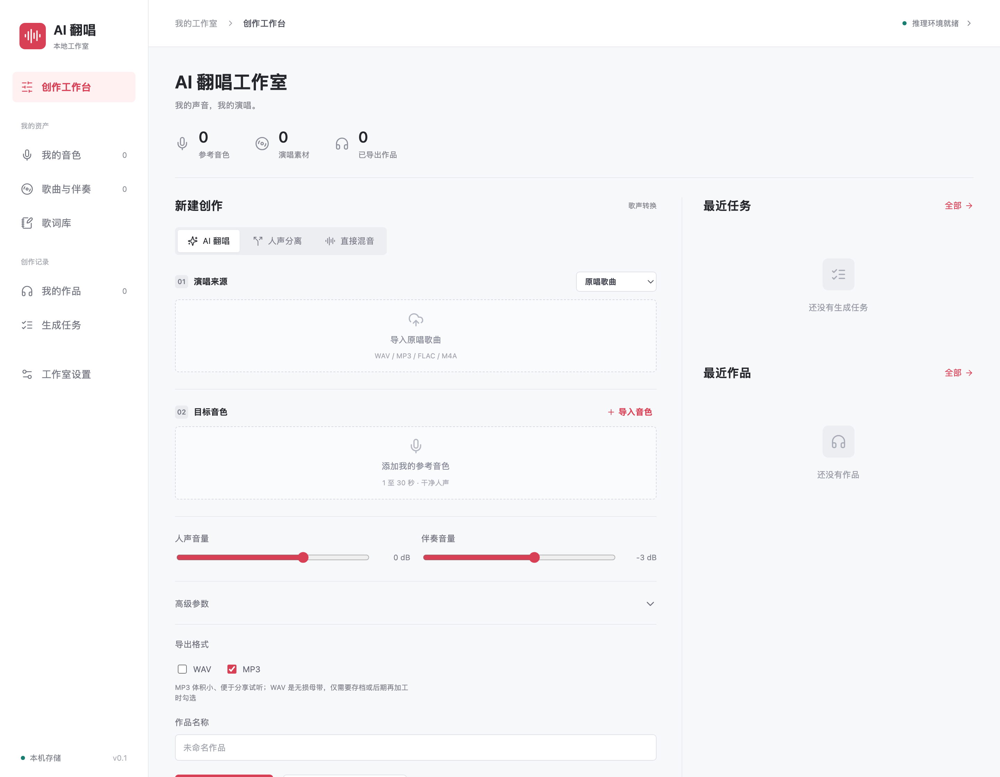

# AI 翻唱工作室

本地运行的 AI 翻唱应用：把歌曲中的人声替换成你自己的音色，生成完整的翻唱作品。上传的音频、任务和作品全部保存在本机，不上传任何服务器。

## 功能特性

- **音色库**：上传 1–30 秒参考录音即可注册你的音色，支持试听、重命名和删除。
- **素材库**：管理原唱歌曲、伴奏、干声录唱，自动读取时长、采样率和波形。
- **歌词库**：编辑歌词或 LRC，保留历史版本，任务创建时自动保存歌词快照（编辑文字不会改变音频中的歌词）。
- **两种创作方式**：
  - 直接上传原唱歌曲，自动分离人声和伴奏后转换音色；
  - 自己跟着伴奏清唱，上传干声后仅做音色转换。
- **参数可调**：人声/伴奏增益、移调、时间偏移、推理步数、音色引导强度。
- **试听片段**：只转换选中的片段快速比较参数，满意后再生成整曲；已完成的翻唱可复用转换干声一键重混，无需重新推理。
- **独立工具**：单独的人声分离、直接混音模式。
- **任务管理**：单任务队列、阶段进度、执行日志、取消、重试、中断恢复。
- **高质量导出**：44.1 kHz / 24-bit WAV 和 320 kbps MP3，支持试听与下载。
- **MCP 工具服务**：内置 13 个 MCP 工具，可让 Claude Code 等 AI 客户端直接调用整个工作流。
- **本地与安全**：SQLite 本地持久化、仅本机访问、上传大小和磁盘余量检查。

## 界面预览



创作工作台：选择音色、上传原唱歌曲或干声、调节转换参数并试听片段，满意后再生成整曲；音色库、素材库、歌词库、作品和任务都在左侧导航中切换。

## 快速开始

### 环境要求

- macOS（推荐 Apple Silicon）
- [uv](https://docs.astral.sh/uv/)、Python 3.12、FFmpeg
- 约 10 GB 可用磁盘空间（AI 模型约 2.6 GB）

### 1. 安装 AI 推理环境（仅首次）

```sh
uv run python scripts/setup_ai.py --models-dir models --source-cdn
models/runtime/bin/python scripts/download_models.py --models-dir models --hf-endpoint https://hf-mirror.com
```

脚本会创建独立的推理环境、下载并校验模型；网络受限时可保留 `--hf-endpoint` 镜像参数。安装可重复运行以续传。

### 2. 启动应用

```sh
npm start
```

等价于 `sh scripts/run.sh`。启动后打开 <http://127.0.0.1:8765>。

端口被占用时换一个：

```sh
COVER_PORT=8766 sh scripts/run.sh
```

后台启动（自动选择可用端口，打印地址和进程号，日志写入 `artifacts/server.log`，停止时 `kill <PID>`）：

```sh
uv run python scripts/start_background.py
```

## MCP 工具服务

项目自带 MCP 服务器（`mcp_server/`），把主要流程编排为 13 个工具，供 Claude Code 等客户端直接调用，无需打开网页：

- `voice_swap`：一键换声——上传音频、匹配音色、提交转换、下载成品到 `~/Downloads`（长歌建议先用 `preview_seconds=15` 试听调参）。
- 素材管理：`list_assets`、`upload_audio`、`delete_asset`、`download_asset`。
- 任务编排：`create_job`、`get_job`、`list_jobs`、`wait_job`、`get_job_log`、`cancel_job`、`retry_job`。
- `studio_status`：查看引擎与存储状态，服务未启动时自动后台拉起。

项目根目录的 `.mcp.json` 已注册 `cover-studio`，在 Claude Code 中打开本仓库即可使用。服务地址默认 `http://127.0.0.1:8765`，可用环境变量 `COVER_URL` 覆盖。

## 数据存储

```text
data/
  assets/          音色、歌曲、伴奏、干声、导出作品
  jobs/            每次任务的参数、歌词快照、日志
  database/        SQLite 元数据
models/            推理环境与模型缓存
settings.json      本机模型与环境路径
```

想把素材库放到外置硬盘时，用 `COVER_DATA_DIR` 指定新位置启动；模型目录可用 `COVER_MODELS_DIR` 或安装脚本配置。环境变量需在每次启动时保持一致。

## 开发与测试

```sh
uv run pytest
uv run ruff check app scripts tests
```

## 许可证

本项目以 [MIT License](LICENSE) 开源。推理所用的上游组件保留各自许可：[Seed-VC](https://github.com/Plachtaa/seed-vc)（GPL-3.0）、[Demucs](https://github.com/facebookresearch/demucs)（MIT）、[Lucide](https://lucide.dev)（ISC）。

## 捐赠

如果这个项目对你有帮助，欢迎扫描下方二维码请作者喝杯咖啡 ☕

<p>
  
</p>
